# Лабораторна робота 3. Модифікація даних та транзакції

## Загальна інформація

- **Здобувач освіти:** Самойло Тарас Костянтинович
- **Група:** ІПЗ-32
- **Обраний рівень складності:** 3
- **СУБД:** PostgreSQL 17 (Supabase), SQL Editor

Мета роботи: здобути практичні навички безпечної модифікації даних, опанувати механізми транзакцій для забезпечення цілісності даних, навчитися працювати з обмеженнями цілісності та каскадними операціями при зміні взаємопов'язаних записів.

Усі запити зібрано у файлі [`lab03-queries.sql`](lab03-queries.sql). Кожен блок має позначку `-- [N-M]`, що збігається з номером розділу звіту та назвою скріншота в `screenshots/`.

### Особливості середовища

- SQL Editor у Supabase виконує весь текст як один запит і показує результат **лише останньої** інструкції. Тому кожен блок закінчується контрольним `SELECT`.
- Якщо в запуску виникає помилка, виконання зупиняється, а все, що виконалось у цьому запуску, відкочується (неявна транзакція).
- Таблиця `categories` у базі вже є з ЛР1, тому категорії книг названо `book_categories`.
- Supabase автоматично відкриває нові таблиці схеми `public` для API-ролей `anon` та `authenticated`. Для всіх таблиць лабораторної ці права відкликано (`REVOKE ALL ... FROM anon, authenticated`).

### Структура бази даних

| Таблиця | Призначення | Рівень |
|---|---|---|
| authors | автори | 1 |
| books | книги (кількість примірників, видавництво, категорія) | 1 |
| readers | читачі (`Active` / `Blocked` / `Inactive`) | 1 |
| lendings | видачі книг | 1 |
| reservations | бронювання книг | 2 |
| audit_log | журнал змін (заповнюється тригерами) | 2 |
| publishers, book_categories | довідники для демонстрації SET NULL / SET DEFAULT | 2 |
| books_versions | версії записів книг | 3 |
| scheduled_operations | відкладені операції | 3 |
| backup_points | контрольні точки (знімки даних у JSONB) | 3 |

---

# РІВЕНЬ 1

## 1-1. Структура бази даних з обмеженнями цілісності

Створено таблиці `authors`, `books`, `readers`, `lendings` з обмеженнями:

- **PRIMARY KEY** (`SERIAL`) у кожній таблиці;
- **NOT NULL** для обов'язкових полів (імена, назва, ISBN, email, `due_date`);
- **UNIQUE**: `books.isbn`, `readers.email`, `readers.library_card_number`;
- **CHECK**:
  - рік народження автора та рік видання;
  - `total_copies >= 0`, `available_copies >= 0`, `available_copies <= total_copies`;
  - статус читача з переліку;
  - `due_date > lending_date`, `return_date >= lending_date`;
- **FOREIGN KEY ... ON DELETE RESTRICT**: `books → authors`, `lendings → books`, `lendings → readers`.

```sql
CREATE TABLE books (
    book_id          SERIAL PRIMARY KEY,
    isbn             VARCHAR(17) UNIQUE NOT NULL,
    title            VARCHAR(200) NOT NULL,
    author_id        INTEGER NOT NULL,
    publication_year INTEGER CHECK (publication_year >= 1450),
    genre            VARCHAR(50),
    total_copies     INTEGER DEFAULT 1 CHECK (total_copies >= 0),
    available_copies INTEGER DEFAULT 1 CHECK (available_copies >= 0),
    created_at       TIMESTAMP DEFAULT CURRENT_TIMESTAMP,
    FOREIGN KEY (author_id) REFERENCES authors(author_id) ON DELETE RESTRICT,
    CHECK (available_copies <= total_copies)
);
```

Результат: запит до `information_schema.table_constraints` повернув 18 обмежень (CHECK, PRIMARY KEY, UNIQUE, FOREIGN KEY) для чотирьох таблиць.

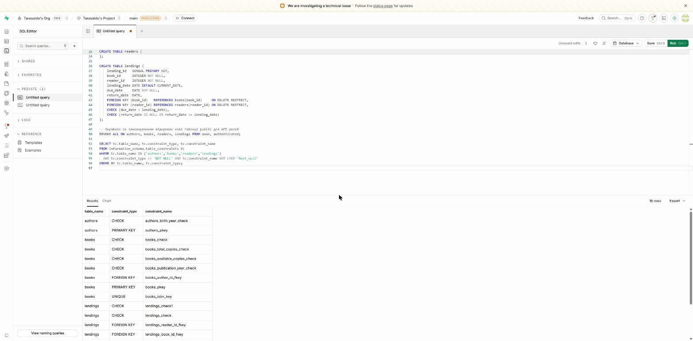

## 1-2. Додавання тестових даних

Використано багаторядковий `INSERT ... VALUES` та `INSERT ... SELECT` (видача книги «Захар Беркут» читачу Коваленку, сформована запитом до `books` і `readers`). Додатково додано неактивного читача для демонстрації безпечного видалення.

```sql
INSERT INTO lendings (book_id, reader_id, lending_date, due_date)
SELECT b.book_id, r.reader_id, CURRENT_DATE - 20, CURRENT_DATE - 6
FROM books b CROSS JOIN readers r
WHERE b.title = 'Захар Беркут' AND r.library_card_number = 'LIB-2024-002';
```

Результат: 5 авторів, 5 книг, 5 читачів, 1 видача. Ця видача вже прострочена, що використовується в рівні 3.

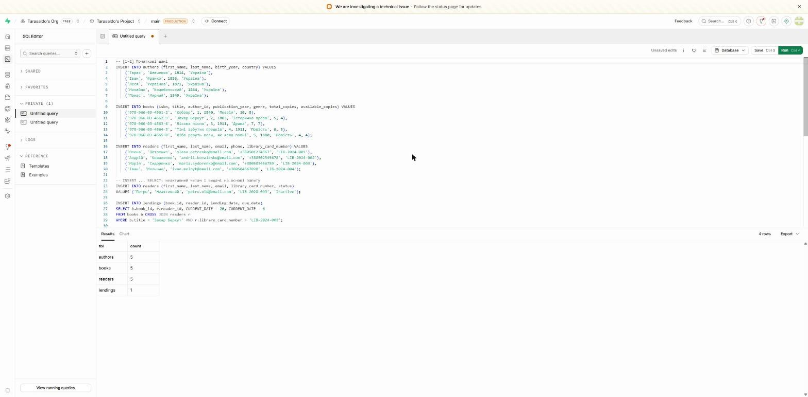

## 1-3. Перевірка обмежень при вставці

Кожна некоректна вставка виконувалась окремо і була відхилена СУБД:

| Блок | Порушення | Код і повідомлення |
|---|---|---|
| 1-3a | дублікат ISBN | `23505 duplicate key value violates unique constraint "books_isbn_key"` |
| 1-3b | неіснуючий автор 999 | `23503 ... violates foreign key constraint "books_author_id_fkey"` |
| 1-3c | `available_copies = 5 > total_copies = 2` | `23514 ... violates check constraint "books_check"` |
| 1-3d | `last_name = NULL` | `23502 null value in column "last_name" ... violates not-null constraint` |

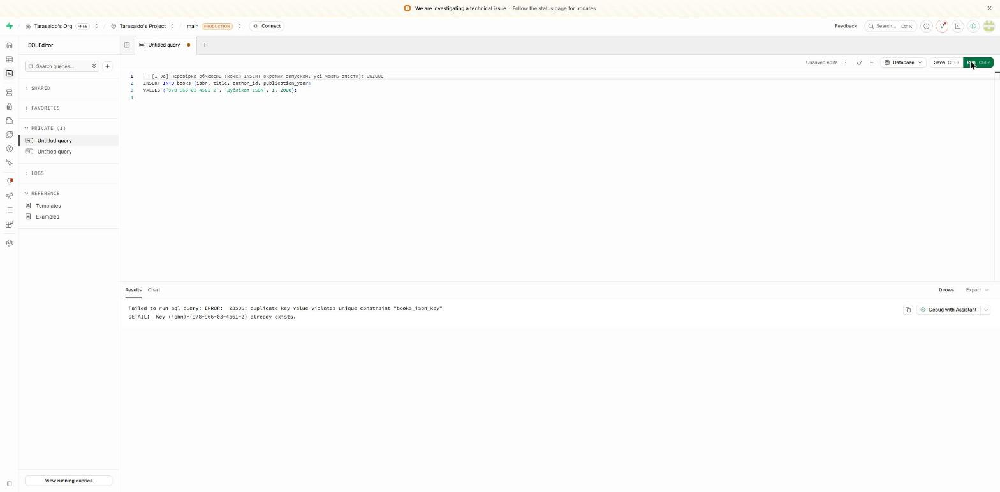
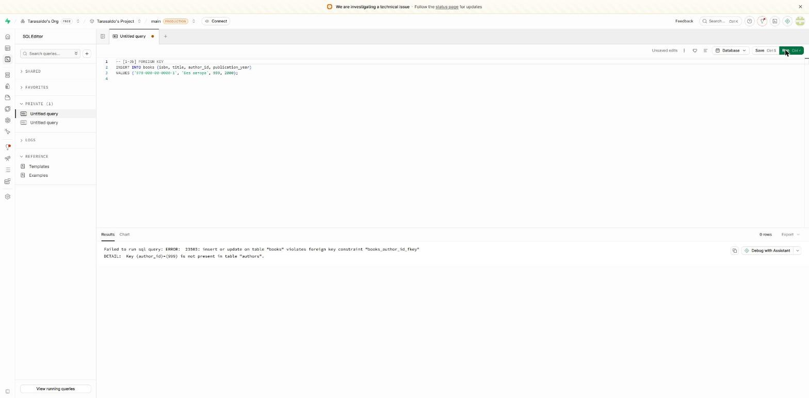

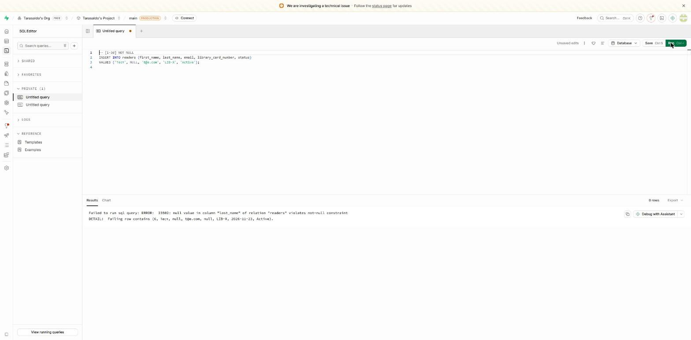

## 1-4. Безпечне оновлення записів

Порядок дій: спочатку `SELECT` з тією самою умовою, потім `UPDATE` з `WHERE` та `RETURNING`. Умова `available_copies > 0` не дає піти в мінус навіть без CHECK.

```sql
UPDATE books
SET available_copies = available_copies - 1
WHERE book_id = 1 AND available_copies > 0
RETURNING book_id, title, available_copies;

-- оновлення з підзапитом
UPDATE books
SET genre = 'Класична поезія'
WHERE author_id IN (SELECT author_id FROM authors WHERE birth_year < 1850)
  AND genre = 'Поезія'
RETURNING book_id, title, genre;
```

Результат: у «Кобзаря» доступні примірники 8 → 7, жанр змінено на «Класична поезія» (на скріншоті результат останнього `RETURNING`).

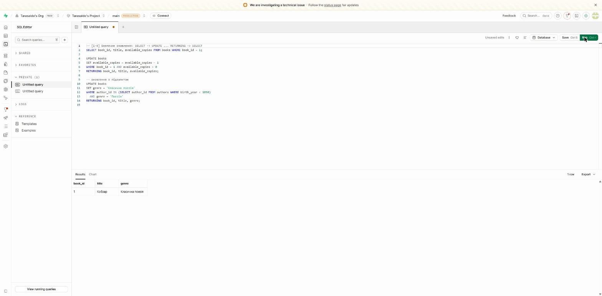

## 1-5. Транзакція видачі книги

Видача книги складається з двох дій, які мають виконатись разом: запис у `lendings` та зменшення `available_copies`.

```sql
BEGIN;
INSERT INTO lendings (book_id, reader_id, due_date)
VALUES (1, 1, CURRENT_DATE + 14);

UPDATE books
SET available_copies = available_copies - 1
WHERE book_id = 1 AND available_copies > 0;
COMMIT;
```

Результат: з'явилась видача №2 («Кобзар», Петренко, повернути до 07.12.2026), доступних примірників стало 6.

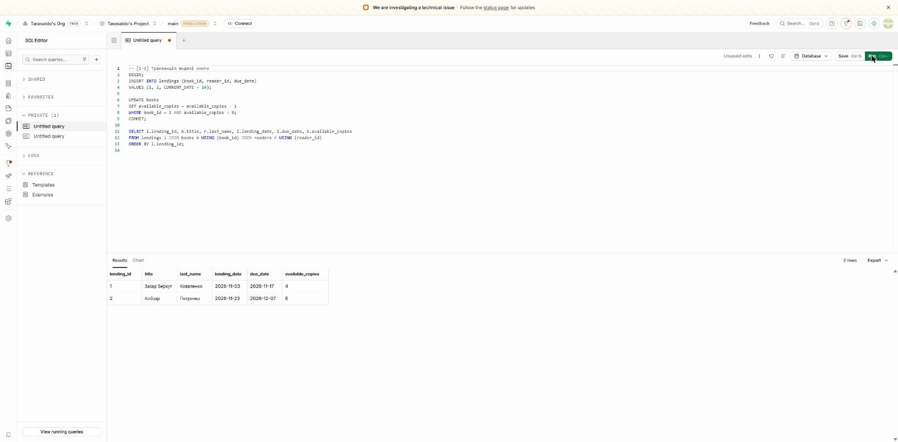

## 1-6, 1-7. ROLLBACK при помилці

У транзакції спочатку успішно виконується `UPDATE` автора, потім `DELETE` цього ж автора порушує зовнішній ключ (у нього є книги).

```sql
BEGIN;
UPDATE authors SET country = 'ЗМІНЕНО' WHERE author_id = 1;
DELETE FROM authors WHERE author_id = 1;   -- ERROR: violates foreign key constraint
COMMIT;
```

Помилка `23503 ... violates foreign key constraint "books_author_id_fkey"` переводить транзакцію в стан aborted, і `COMMIT` уже нічого не підтверджує: транзакція відкочується повністю. Перевірка (1-7) показує, що `country` у Шевченка залишилось «Україна», тобто відкотився і успішний `UPDATE`. Це атомарність.


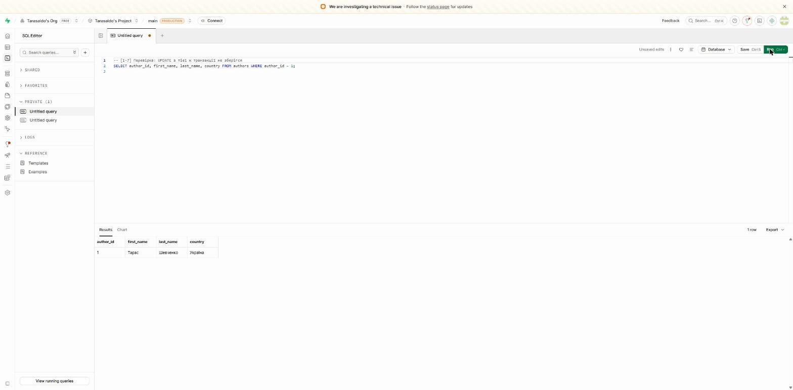

## 1-8. Явний ROLLBACK

```sql
BEGIN;
DELETE FROM lendings WHERE return_date IS NULL;
SELECT COUNT(*) AS inside_tx FROM lendings;   -- 0
ROLLBACK;
SELECT COUNT(*) AS after_rollback FROM lendings;
```

Усередині транзакції видачі були видалені, після `ROLLBACK` їх знову 2.

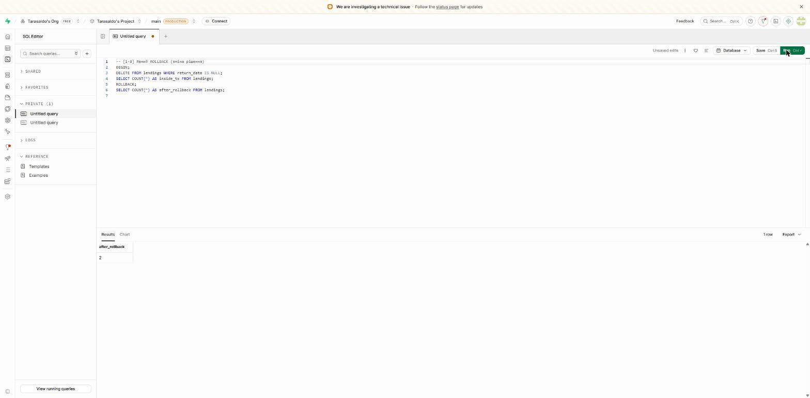

## 1-9, 1-10. Безпечне видалення

Перед видаленням виконано `SELECT` з тією самою умовою. Видаляються лише неактивні читачі без неповернених книг:

```sql
DELETE FROM readers
WHERE status = 'Inactive'
  AND reader_id NOT IN (SELECT reader_id FROM lendings WHERE return_date IS NULL)
RETURNING reader_id, first_name, last_name, status;
```

Результат: видалено одного читача (Петро Неактивний). Спроба видалити читача №2, у якого є видача, блокується обмеженням `lendings_reader_id_fkey` (`ON DELETE RESTRICT`).

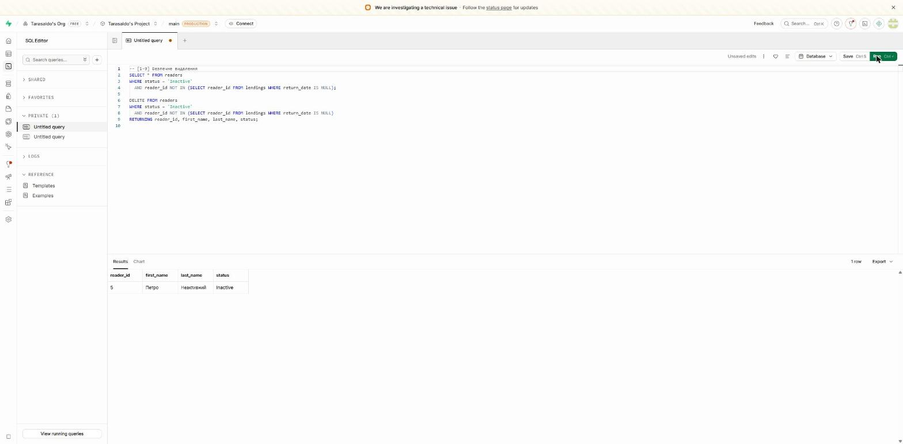
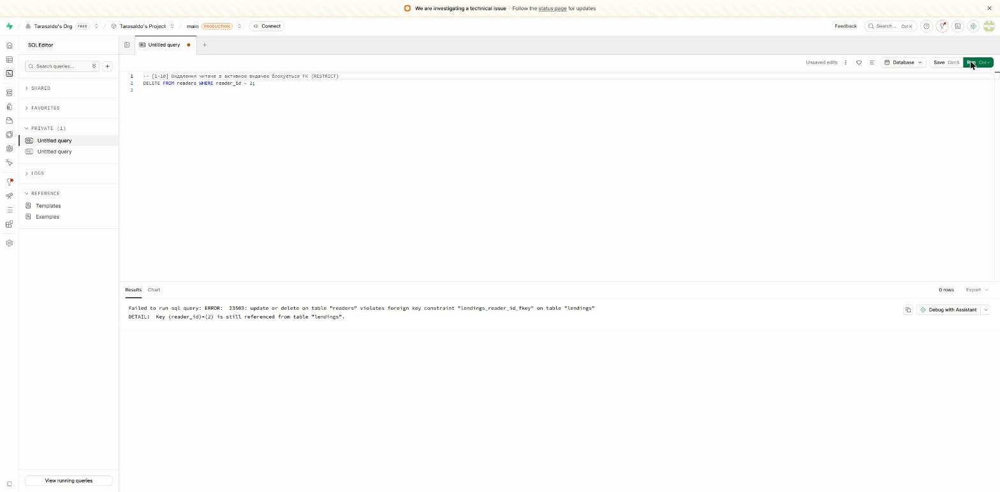

---

# РІВЕНЬ 2

## 2-1. Нові таблиці та каскадні зв'язки всіх типів

Додано `reservations`, `audit_log`, а також `publishers` і `book_categories`, щоб показати всі типи поведінки зовнішніх ключів:

```sql
ALTER TABLE books
    ADD COLUMN publisher_id INTEGER REFERENCES publishers(publisher_id) ON DELETE SET NULL,
    ADD COLUMN category_id  INTEGER DEFAULT 1 REFERENCES book_categories(category_id) ON DELETE SET DEFAULT;

ALTER TABLE reservations
    ADD COLUMN card_number VARCHAR(20) REFERENCES readers(library_card_number) ON UPDATE CASCADE;
```

Запит до `pg_constraint` показує підсумкову схему зв'язків:

| Дочірня таблиця | Батьківська | ON DELETE | ON UPDATE |
|---|---|---|---|
| books.author_id | authors | RESTRICT | NO ACTION |
| books.category_id | book_categories | SET DEFAULT | NO ACTION |
| books.publisher_id | publishers | SET NULL | NO ACTION |
| lendings.book_id / reader_id | books / readers | RESTRICT | NO ACTION |
| reservations.book_id / reader_id | books / readers | CASCADE | NO ACTION |
| reservations.card_number | readers | NO ACTION | CASCADE |

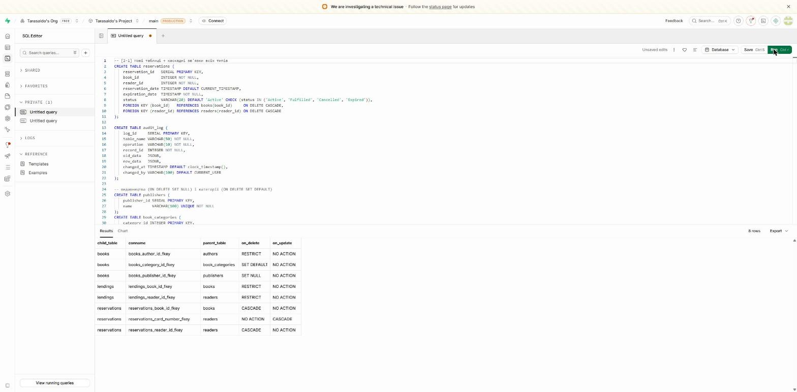

## 2-2. Тригер для автоматичного ведення історії змін

Одна універсальна функція обслуговує чотири таблиці. Назву стовпця первинного ключа передано через аргумент тригера `TG_ARGV[0]`, а назву таблиці взято з `TG_TABLE_NAME`. Час фіксується через `clock_timestamp()`, щоб зміни в одній транзакції мали різний час. Змінна `app.restoring` дозволяє вимкнути аудит під час відновлення з бекапу (рівень 3).

```sql
CREATE OR REPLACE FUNCTION log_changes()
RETURNS TRIGGER AS $$
DECLARE
    v_pk TEXT := TG_ARGV[0];
BEGIN
    IF current_setting('app.restoring', true) = 'on' THEN
        RETURN NULL;
    END IF;
    IF TG_OP = 'INSERT' THEN
        INSERT INTO audit_log (table_name, operation, record_id, new_data)
        VALUES (TG_TABLE_NAME, 'INSERT', (to_jsonb(NEW)->>v_pk)::int, to_jsonb(NEW));
    ELSIF TG_OP = 'UPDATE' THEN
        INSERT INTO audit_log (table_name, operation, record_id, old_data, new_data)
        VALUES (TG_TABLE_NAME, 'UPDATE', (to_jsonb(NEW)->>v_pk)::int, to_jsonb(OLD), to_jsonb(NEW));
    ELSE
        INSERT INTO audit_log (table_name, operation, record_id, old_data)
        VALUES (TG_TABLE_NAME, 'DELETE', (to_jsonb(OLD)->>v_pk)::int, to_jsonb(OLD));
    END IF;
    RETURN NULL;
END;
$$ LANGUAGE plpgsql;

CREATE TRIGGER books_audit_trigger AFTER INSERT OR UPDATE OR DELETE ON books
    FOR EACH ROW EXECUTE FUNCTION log_changes('book_id');
-- аналогічно для readers, lendings, reservations
```

Перевірка: після `UPDATE books ... WHERE book_id = 1` у журналі з'явився запис `books / UPDATE / 1 / Кобзар / 6 → 7 / postgres`.

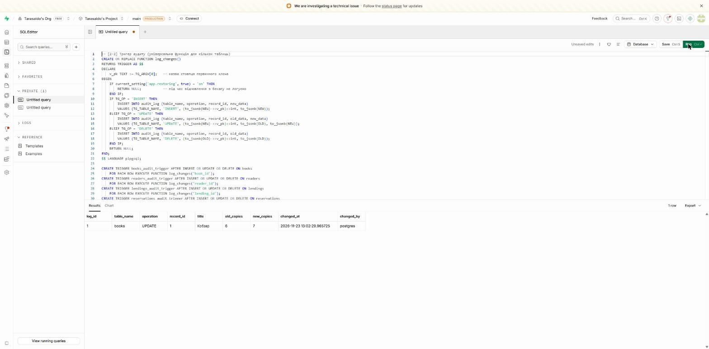

## 2-3, 2-4. Складна транзакція: повернення книги та видача наступному в черзі

Створено два активні бронювання книги №2 (читачі 3 і 4, бронювання читача 4 старіше). Транзакція виконує п'ять операцій різних типів:
1. закриває видачу №1;
2. повертає примірник;
3. знаходить найстаріше активне бронювання (`FOR UPDATE`, щоб його не забрала паралельна транзакція) і позначає його `Fulfilled`;
4. одразу оформлює видачу цьому читачеві;
5. знову зменшує кількість доступних примірників.

```sql
BEGIN;
UPDATE lendings SET return_date = CURRENT_DATE
WHERE lending_id = 1 AND return_date IS NULL;
UPDATE books SET available_copies = available_copies + 1
WHERE book_id = (SELECT book_id FROM lendings WHERE lending_id = 1);
WITH next_res AS (
    SELECT reservation_id, reader_id, book_id
    FROM reservations
    WHERE book_id = (SELECT book_id FROM lendings WHERE lending_id = 1) AND status = 'Active'
    ORDER BY reservation_date
    LIMIT 1
    FOR UPDATE
), upd AS (
    UPDATE reservations r SET status = 'Fulfilled'
    FROM next_res n WHERE r.reservation_id = n.reservation_id
    RETURNING r.reader_id, r.book_id
)
INSERT INTO lendings (book_id, reader_id, due_date)
SELECT book_id, reader_id, CURRENT_DATE + 14 FROM upd;
UPDATE books SET available_copies = available_copies - 1
WHERE book_id = (SELECT book_id FROM lendings WHERE lending_id = 1);
COMMIT;
```

Результат:
- видача №1 закрита датою 23.11.2026;
- бронювання №2 (читач 4) отримало статус `Fulfilled`;
- з'явилась видача №3 (книга 2, читач 4);
- бронювання №1 лишилось активним;
- доступних примірників книги №2 так і залишилось 4: одну повернули, іншу одразу видали.


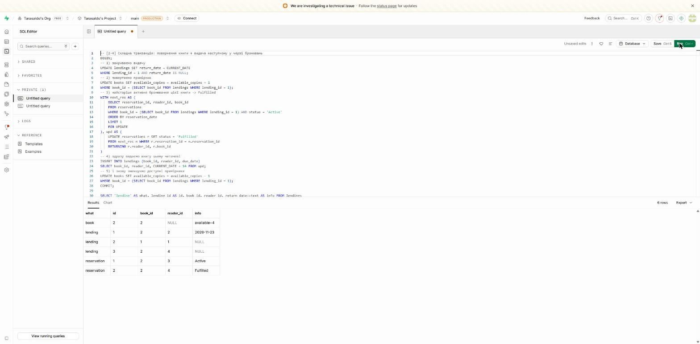

## 2-5, 2-6. Точки збереження SAVEPOINT

**2-5. Частковий відкат без помилки.** Після додавання автора ставиться `SAVEPOINT after_author`. Книгу з помилковою назвою та подальший `UPDATE` скасовує `ROLLBACK TO SAVEPOINT after_author`, а автор лишається в транзакції. Потім додається правильна книга і транзакція підтверджується.

```sql
BEGIN;
INSERT INTO authors (...) VALUES ('Ольга', 'Кобилянська', 1863, 'Україна');
SAVEPOINT after_author;
INSERT INTO books (...) VALUES ('978-966-03-4566-7', 'Земля (помилкова назва)', ...);
SAVEPOINT after_book;
UPDATE books SET available_copies = 0 WHERE isbn = '978-966-03-4566-7';
ROLLBACK TO SAVEPOINT after_author;   -- скасовує книгу і UPDATE, автор лишається
INSERT INTO books (...) VALUES ('978-966-03-4567-4', 'Земля', ...);
COMMIT;
```

Результат: у Кобилянської одна книга, «Земля» з ISBN `...4567-4`; книги з `...4566-7` у базі немає.

Примітка: `LASTVAL()` з прикладу в методичці тут не підходить. Після вставки книги та спрацювання тригерів він повертає значення іншої послідовності, тому `author_id` береться підзапитом.

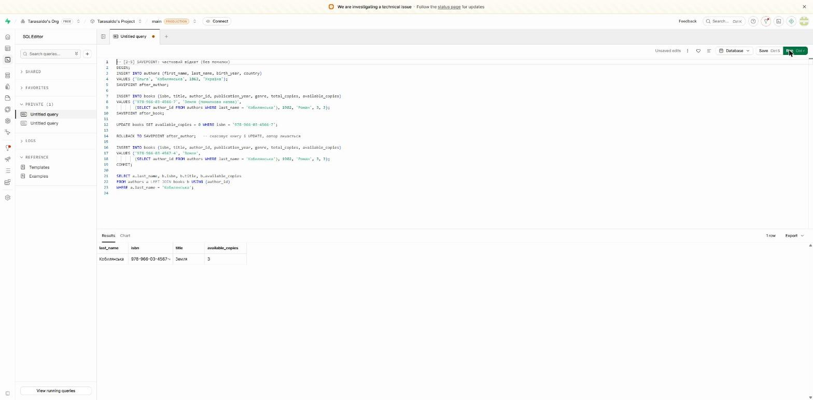

**2-6. Відкат до точки збереження при помилці.** SQL Editor зупиняє весь запуск на першій помилці, тому сценарій із дублікатом ISBN реалізовано блоком PL/pgSQL. Блок `BEGIN ... EXCEPTION` на вході ставить неявний SAVEPOINT, а в разі помилки виконує `ROLLBACK TO SAVEPOINT`: скасовується лише невдала вставка, вставка автора зберігається.

```sql
DO $$
BEGIN
    INSERT INTO authors (...) VALUES ('Василь', 'Стефаник', 1871, 'Україна');
    BEGIN   -- неявний SAVEPOINT
        INSERT INTO books (...) VALUES ('978-966-03-4567-4', 'Дублікат ISBN', ...);
    EXCEPTION WHEN unique_violation THEN   -- ROLLBACK TO SAVEPOINT
        INSERT INTO books (...) VALUES ('978-966-03-4568-1', 'Камінний хрест', ...);
    END;
END $$;
```

Результат: Стефаник доданий разом із книгою «Камінний хрест».

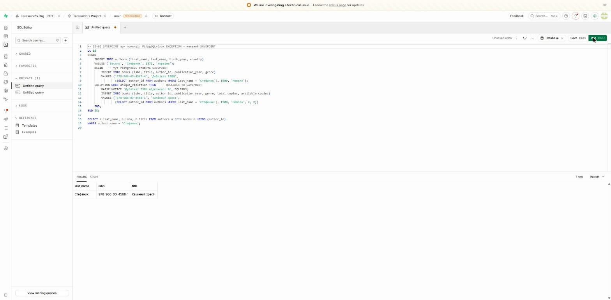

## 2-7 – 2-10. Каскадні операції

Для демонстрації створено тестового автора, книгу (видавництво 2, категорія 3) та два бронювання цієї книги (2-7). Далі:

```sql
DELETE FROM publishers WHERE name = 'А-БА-БА-ГА-ЛА-МА-ГА';   -- ON DELETE SET NULL
DELETE FROM book_categories WHERE category_id = 3;           -- ON DELETE SET DEFAULT
UPDATE readers SET library_card_number = 'LIB-2025-003'
WHERE library_card_number = 'LIB-2024-003';                 -- ON UPDATE CASCADE
DELETE FROM books WHERE isbn = '978-966-00-0000-0';          -- ON DELETE CASCADE
DELETE FROM authors WHERE last_name = 'Франко';              -- ON DELETE RESTRICT
```

| Операція | Що сталося з дочірніми записами |
|---|---|
| видалено видавництво 2 | у тестової книги `publisher_id` став `NULL` |
| видалено категорію 3 | книги 4, 5 і тестова отримали `category_id = 1` (значення DEFAULT) |
| змінено номер читацького квитка | у бронюваннях №1 і №4 `card_number` автоматично змінився на `LIB-2025-003` |
| видалено тестову книгу | її бронювання №3 і №4 видалились автоматично |
| видалення Франка | відхилено: `books_author_id_fkey` (RESTRICT) |

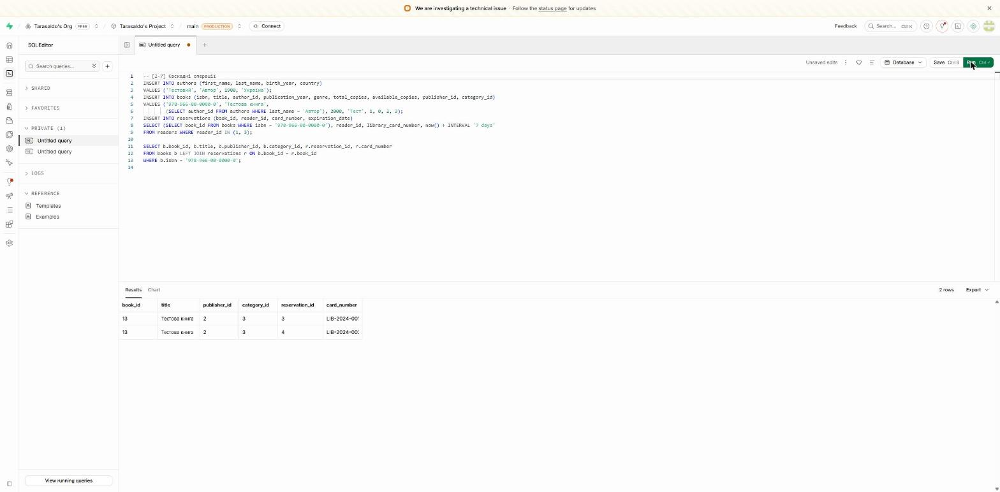
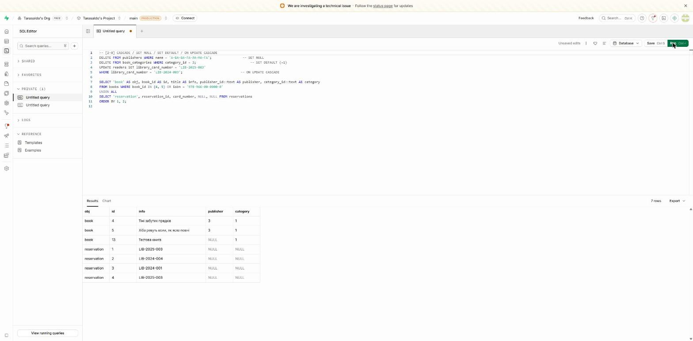
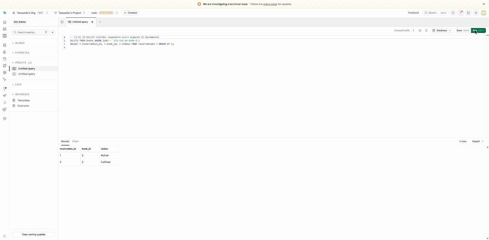


## 2-11 – 2-15. Блокування записів при паралельному доступі

Для імітації кількох користувачів SQL Editor відкрито у трьох вкладках браузера. Кожна вкладка має власне з'єднання з базою.

**Вкладка A** блокує рядок книги №3 і тримає блокування 40 секунд:

```sql
BEGIN;
SELECT book_id, title, available_copies FROM books WHERE book_id = 3 FOR UPDATE;
SELECT pg_sleep(40);
UPDATE books SET available_copies = available_copies - 1 WHERE book_id = 3;
COMMIT;
```

**Вкладка B** одночасно намагається змінити той самий рядок і запам'ятовує момент старту:

```sql
SELECT set_config('app.t0', clock_timestamp()::text, false);
BEGIN;
SELECT book_id, available_copies FROM books WHERE book_id = 3 FOR UPDATE;
UPDATE books SET available_copies = available_copies - 1 WHERE book_id = 3;
COMMIT;
SELECT book_id, available_copies,
       clock_timestamp() - current_setting('app.t0')::timestamptz AS waited
FROM books WHERE book_id = 3;
```

**Вкладка C** у цей час дивиться в `pg_stat_activity`, хто кого блокує (2-13):

| pid | state | wait_event_type | wait_event | blocked_by |
|---|---|---|---|---|
| 7579 (A) | active | Timeout | PgSleep | [] |
| 7580 (B) | active | **Lock** | **transactionid** | **[7579]** |

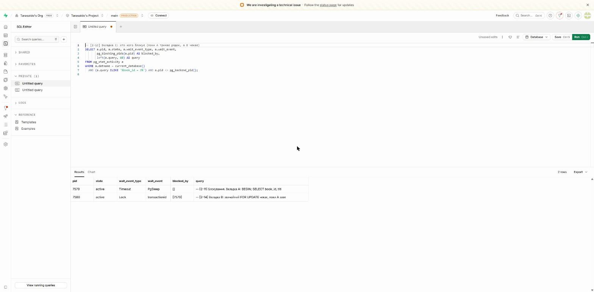

Після завершення A (`available_copies` 7 → 6) транзакція B отримала блокування і зменшила значення до 5, прочекавши **37 секунд**. Обидва зменшення застосовано послідовно, жодне оновлення не втрачено.

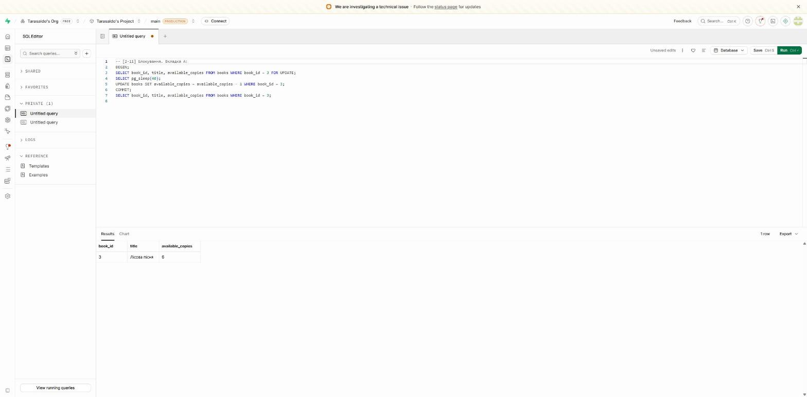
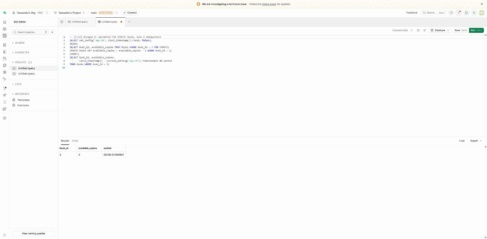

Під час другого запуску вкладки A показано два режими, які не чекають на блокування:
- `FOR UPDATE NOWAIT` (2-12) одразу завершується помилкою `55P03: could not obtain lock on row in relation "books"`. Це зручно, коли краще повідомити користувача, ніж чекати;
- `FOR UPDATE SKIP LOCKED` (2-15) повертає 6 книг без заблокованої книги №3. Такий режим використовують для черг завдань, коли кілька обробників беруть різні записи. Його застосовано у виконавці відкладених операцій (3-4).

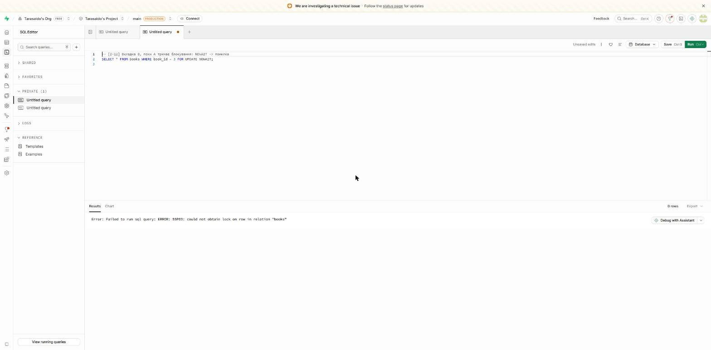
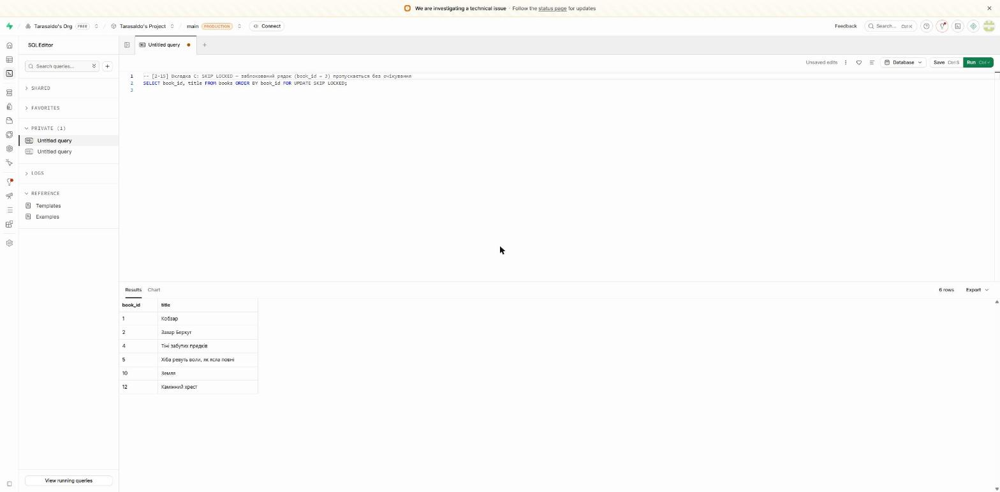

---

# РІВЕНЬ 3

## 3-1 – 3-3. Система версіонування записів

Таблиця `books_versions` зберігає повну копію рядка (JSONB) для кожної версії з інтервалом дії `[valid_from, valid_to)`. Тригер `AFTER INSERT OR UPDATE OR DELETE` закриває поточну версію і створює нову. Під час видалення остання версія одразу отримує `valid_to`. Для вже наявних книг створено початкові версії з позначкою `INITIAL`.

```sql
CREATE OR REPLACE FUNCTION create_book_version()
RETURNS TRIGGER AS $$
DECLARE
    v_row     books;
    v_version INTEGER;
BEGIN
    IF current_setting('app.restoring', true) = 'on' THEN RETURN NULL; END IF;
    IF TG_OP = 'DELETE' THEN v_row := OLD; ELSE v_row := NEW; END IF;

    UPDATE books_versions SET valid_to = clock_timestamp()
    WHERE book_id = v_row.book_id AND valid_to IS NULL;

    SELECT COALESCE(MAX(version_number), 0) + 1 INTO v_version
    FROM books_versions WHERE book_id = v_row.book_id;

    INSERT INTO books_versions (book_id, version_number, operation, data, valid_to)
    VALUES (v_row.book_id, v_version, TG_OP, to_jsonb(v_row),
            CASE WHEN TG_OP = 'DELETE' THEN clock_timestamp() END);
    RETURN NULL;
END;
$$ LANGUAGE plpgsql;
```

Додаткові функції:
- `get_book_version(book_id, timestamp)` повертає стан книги на будь-який момент часу;
- `restore_book_version(book_id, version)` повертає книгу до вказаної версії. Відкат не стирає історію, а створює нову версію.

Демонстрація для «Лісової пісні»:
- 3-2: дві зміни дали версії 2 (`total_copies` 7 → 12) і 3 (нова назва);
- 3-3: `get_book_version` для моменту кожної версії повертає тодішні назву та кількість;
- 3-3b: відкат до версії 1 створив версію 5 зі старими значеннями (назва «Лісова пісня», 7/4).

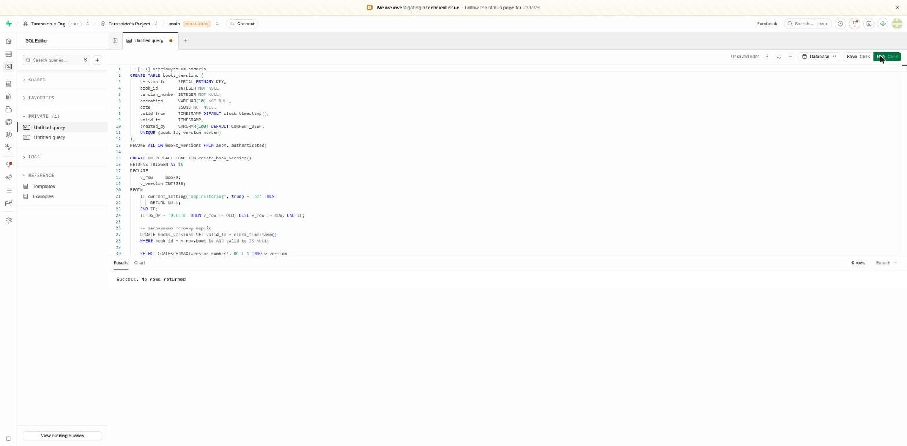
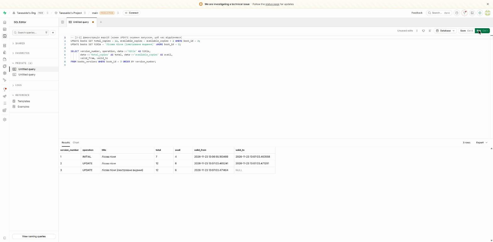
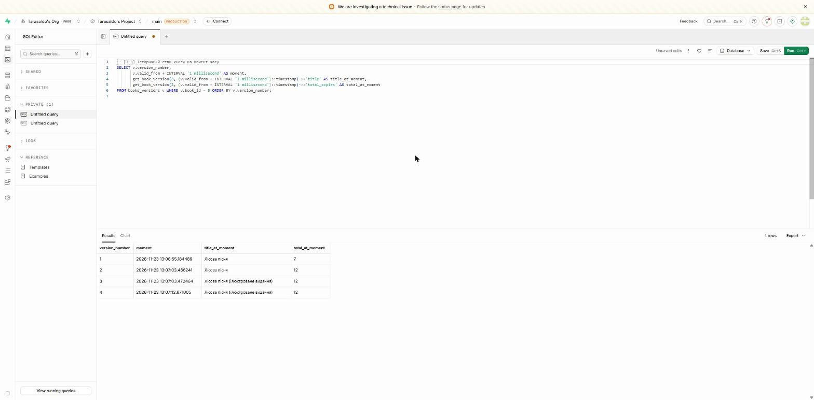
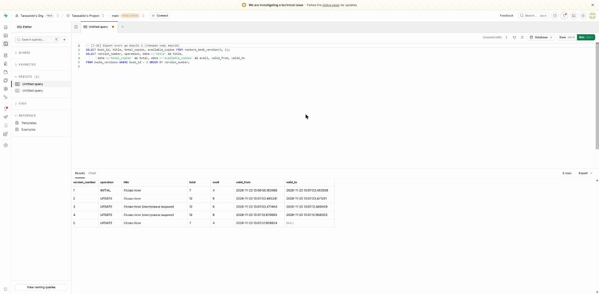

## 3-4, 3-5. Відкладені операції з автоматичним виконанням

Таблиця `scheduled_operations` зберігає тип операції, параметри в JSONB, час виконання та статус. Функція `execute_scheduled_operations()`:
- вибирає операції `Pending`, час яких настав, з `FOR UPDATE SKIP LOCKED`, щоб два паралельні виконавці не взяли одну операцію;
- кожну операцію виконує у власному блоці `BEGIN ... EXCEPTION`, тобто у власній точці збереження. Помилка однієї операції позначає її `Failed` з текстом помилки і не скасовує інші;
- якщо цільовий запис не знайдено (`ROW_COUNT = 0`), вважає операцію невдалою.

**Автоматичне виконання** реалізовано через розширення `pg_cron`, яке Supabase надає з коробки:

```sql
CREATE EXTENSION IF NOT EXISTS pg_cron;
SELECT cron.schedule('library-scheduled-ops', '* * * * *',
                     'SELECT public.execute_scheduled_operations()');
```

Заплановано 4 операції: три на «через хвилину» і одну на завтра. Бронювання №2 на той момент уже мало статус `Fulfilled`, тому до запуску операцію №1 перенацілено на активне бронювання №1 (блок 3-4b у файлі).

Результат о 13:10:00 (запуск pg_cron, 3-5a):

| № | Тип | Статус | Примітка |
|---|---|---|---|
| 1 | EXPIRE_RESERVATION | Executed | бронювання №1 → `Expired` |
| 2 | BLOCK_READER | Executed | читач №4 → `Blocked` |
| 3 | UPDATE_BOOK_COPIES | Failed | «Цільовий запис не знайдено ({"book_id": 999, ...})» |
| 4 | ACTIVATE_READER | Pending | запланована на наступну добу |

Журнал `cron.job_run_details` (3-5) підтверджує, що завдання запускалось щохвилини зі статусом `succeeded`.

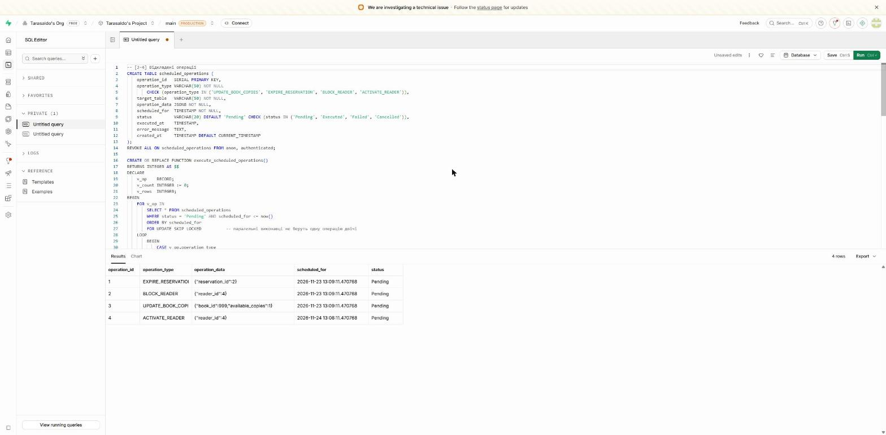
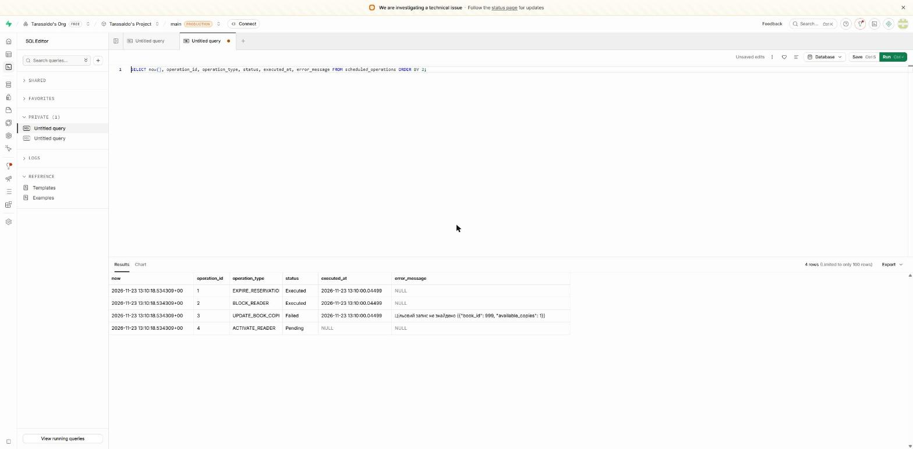
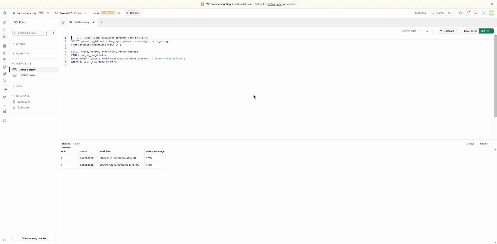

## 3-6 – 3-8. Складна бізнес-логіка у збережених процедурах

- **`extend_lending(lending_id, days)`** (функція, повертає `success / message / new_due_date`) блокує рядок видачі (`FOR UPDATE OF l`) і продовжує термін лише за таких умов:
  - видача існує і книгу ще не повернуто;
  - читач не заблокований;
  - у читача немає прострочених книг;
  - на книгу немає активних бронювань.
- **`issue_book(book_id, reader_id, days)`** (процедура, `CALL`) оформлює видачу книги:
  - перевіряє, що читач існує і має статус `Active`;
  - перевіряє ліміт у 5 книг на руках;
  - блокує рядок книги і перевіряє наявність вільного примірника;
  - створює видачу, зменшує кількість примірників і закриває бронювання цього читача;
  - помилки повертає через `RAISE EXCEPTION`, тому вся операція відкочується.
- **`return_book(lending_id)`** (процедура) закриває видачу і повертає примірник.

```sql
CALL issue_book(4, 1);
SELECT l.lending_id, l.book_id, r.last_name, l.due_date AS old_due,
       e.success, e.message, e.new_due_date
FROM lendings l JOIN readers r USING (reader_id),
     LATERAL extend_lending(l.lending_id, 14) e
WHERE l.return_date IS NULL ORDER BY l.lending_id;
```

Результат (3-7):
- `issue_book` створив видачу №4;
- видачі Петренко №2 і №4 продовжено до 21.12.2026;
- для видачі №3 відмовлено з повідомленням «Читач заблокований»: читача №4 заблокувала відкладена операція.

`CALL issue_book(3, 4)` (3-8) завершився помилкою `P0001: Читач 4 має статус Blocked`.

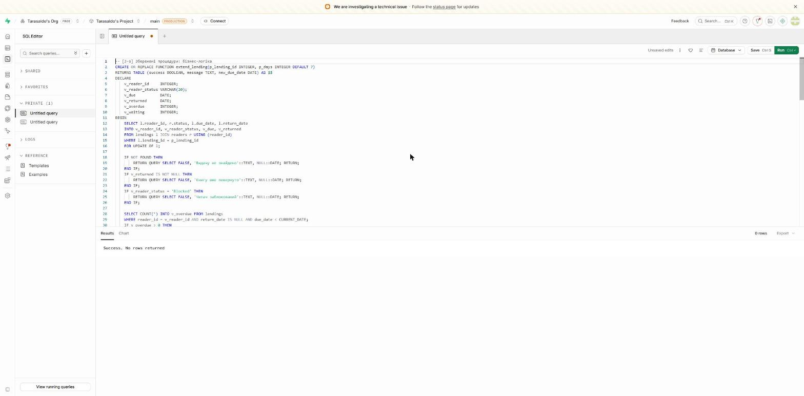
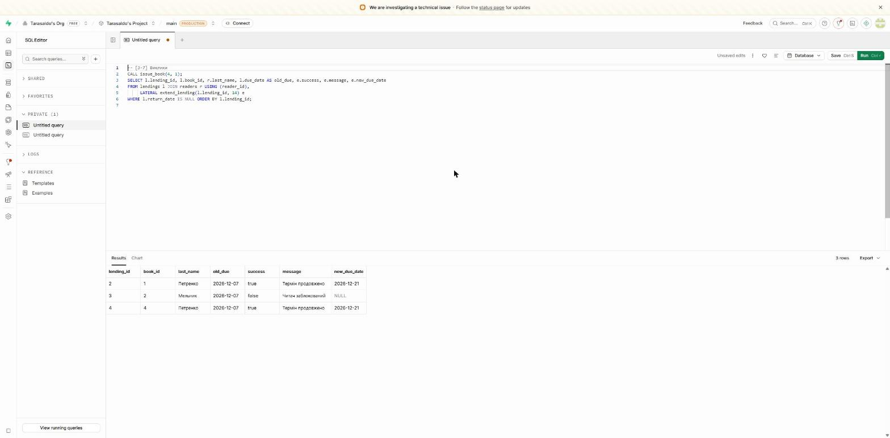
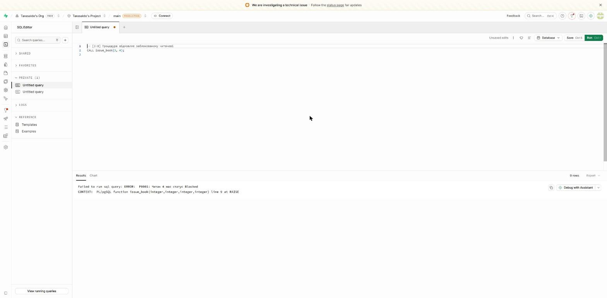

## 3-9 – 3-13. Система прав доступу на рівні операцій модифікації

| Роль | Права |
|---|---|
| `librarian_read` | лише `SELECT` на таблиці бібліотеки |
| `librarian_write` | успадковує `librarian_read`; `INSERT, UPDATE` на books, lendings, reservations; `DELETE` лише на reservations; **`UPDATE (status, phone, email)` на readers, тобто тільки окремі стовпці**; `EXECUTE` процедур; запис у журнали аудиту/версій |
| `library_admin` | усі права на таблиці й послідовності |

Користувачі: `librarian1 → librarian_read`, `librarian2 → librarian_write`, `admin1 → library_admin`. Оскільки база доступна з інтернету, а файл лежить у публічному репозиторії, користувачів створено як `NOLOGIN`, і перевірка прав виконується через `SET LOCAL ROLE`. У реальній системі це були б `CREATE USER ... WITH PASSWORD`. `SET LOCAL` діє лише до кінця транзакції, тому з'єднання SQL Editor не залишається в чужій ролі.

| Блок | Дія | Результат |
|---|---|---|
| 3-10 | `librarian1`: `SELECT` з books | дозволено (`current_user = librarian1`, 7 книг) |
| 3-11 | `librarian1`: `UPDATE books` | `42501: permission denied for table books` |
| 3-12 | `librarian2`: `UPDATE books` | дозволено; в `audit_log` записано `changed_by = librarian2` |
| 3-13 | `librarian2`: `DELETE FROM authors` | `42501: permission denied for table authors` |
| 3-13b | `librarian2`: змінити `first_name` читача | `42501: permission denied for table readers` (права є лише на status/phone/email) |

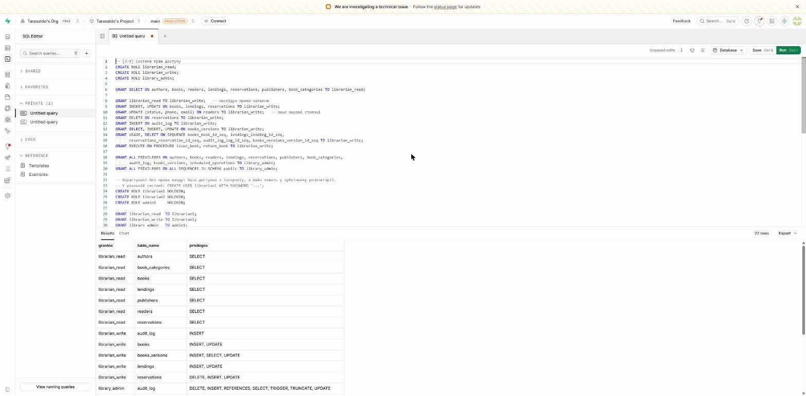


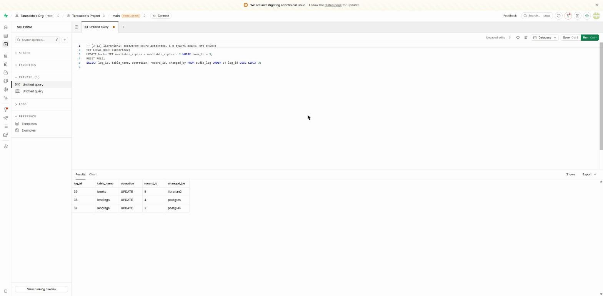

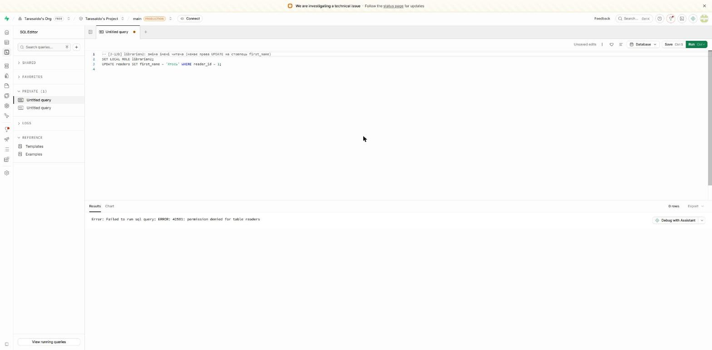

## 3-14 – 3-17. Автоматичні контрольні точки та відновлення після збою

- `create_backup_point(name, description)` зберігає в `backup_points` знімок семи таблиць (JSONB-масиви рядків).
- `restore_from_backup(backup_id)` відновлює дані з контрольної точки:
  - спочатку **автоматично створює ще одну контрольну точку** з поточним станом, щоб відновлення можна було скасувати;
  - вмикає `app.restoring = on` (лише в межах транзакції), тому тригери аудиту та версіонування не засмічують історію;
  - очищує таблиці одним `TRUNCATE` і вставляє рядки через `jsonb_populate_recordset`, у порядку батьківські → дочірні;
  - виставляє лічильники `SERIAL` через `setval`;
  - повертає кількість відновлених рядків по кожній таблиці.

  Уся функція виконується в одній транзакції: якщо будь-який крок упаде, дані залишаться як були.
- **Автоматичні контрольні точки:** завдання pg_cron `library-daily-backup` щодня о 02:00 викликає `create_backup_point`.

```sql
SELECT cron.schedule('library-daily-backup', '0 2 * * *',
       $$SELECT public.create_backup_point('auto: daily ' || to_char(now(), 'YYYY-MM-DD'), 'pg_cron')$$);
```

Сценарій:
1. Створено контрольну точку «Before major update» (3-14).
2. Імітовано збій (3-15): `UPDATE books SET available_copies = 0` і `DELETE FROM reservations` без `WHERE`. Supabase попередив про руйнівну операцію, після підтвердження в усіх книг стало 0 примірників.
3. Відновлення (3-16): відновлено 2 категорії, 2 видавництва, 8 авторів, 7 книг, 4 читачі, 4 видачі, 2 бронювання.
4. Перевірка (3-17): кількість примірників повернулась до значень на момент контрольної точки («Кобзар» 7/10, «Захар Беркут» 4/5 тощо).

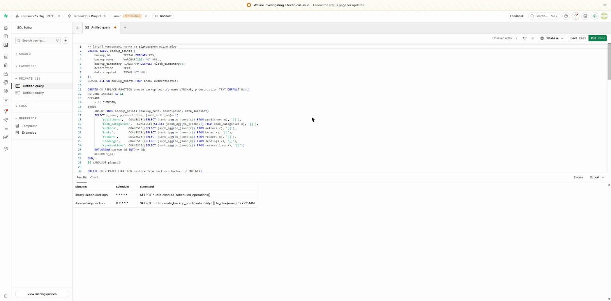
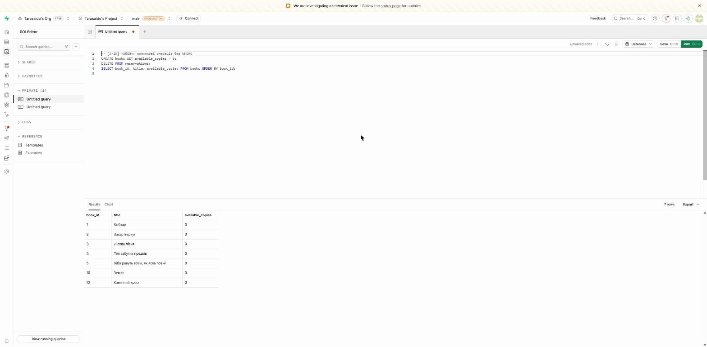
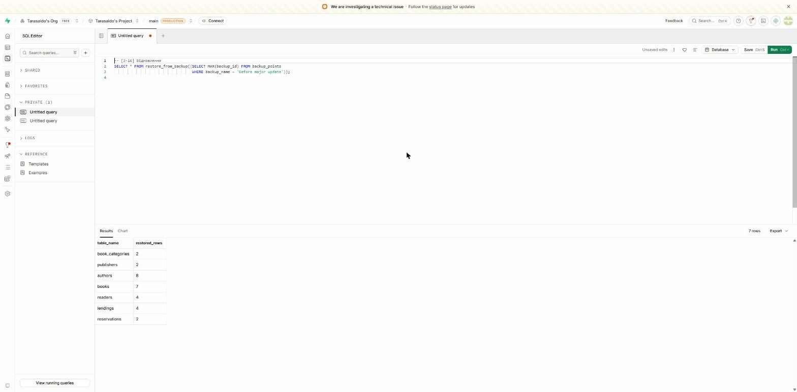
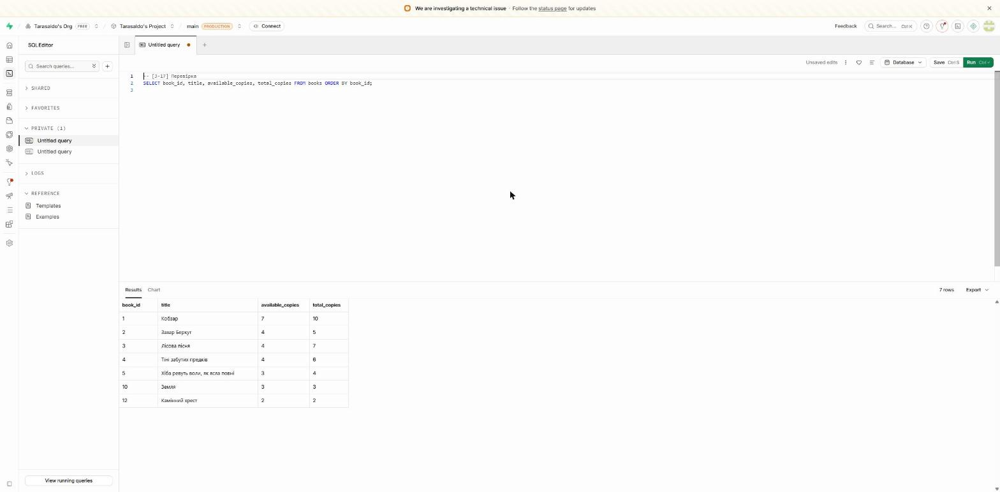

## 3-18 – 3-22. Інтерфейс перегляду та відкату змін за період

**Представлення `books_change_history`** формує зрозумілий опис кожної зміни книги. Для `UPDATE` воно порівнює `old_data` і `new_data` через `jsonb_each` і виводить **усі** змінені поля у вигляді `поле: старе → нове`, а не лише кількість примірників, як у прикладі методички. У прикладі також бракувало дужок навколо `->>`, і конкатенація ламалась.

```sql
CREATE OR REPLACE VIEW books_change_history AS
SELECT a.log_id, a.operation, a.record_id AS book_id,
       COALESCE(a.new_data->>'title', a.old_data->>'title') AS title,
       CASE
           WHEN a.operation = 'INSERT' THEN 'Додано нову книгу'
           WHEN a.operation = 'DELETE' THEN 'Видалено книгу'
           ELSE 'Оновлено: ' || (
               SELECT string_agg(n.key || ': ' || COALESCE(a.old_data->>n.key, 'NULL')
                                 || ' → ' || COALESCE(n.value #>> '{}', 'NULL'), '; ')
               FROM jsonb_each(a.new_data) n
               WHERE n.value IS DISTINCT FROM a.old_data->n.key)
       END AS change_description,
       a.changed_at, a.changed_by
FROM audit_log a
WHERE a.table_name = 'books';
```

Також створено:
- `all_changes_history`: зведена історія по всіх таблицях з JSON-об'єктом змінених полів `{поле: [старе, нове]}`;
- `get_changes_report(від, до)`: статистика INSERT/UPDATE/DELETE по днях і таблицях;
- `rollback_books_changes(від, до)`: відкат усіх змін книг за період у зворотному порядку. `UPDATE` повертає старі значення, `INSERT` видаляє додану книгу, `DELETE` відновлює видалену.

**3-19, перегляд історії.** Видно, що записи 40–46 (збій із 3-15) змінили `available_copies` до 0. Запис 39 зроблений користувачем `librarian2`. Самого відновлення з бекапу в журналі немає, бо під час нього аудит вимкнено. Запис 31 має порожній опис: це `UPDATE`, який нічого фактично не змінив (відкат книги до її поточної версії).

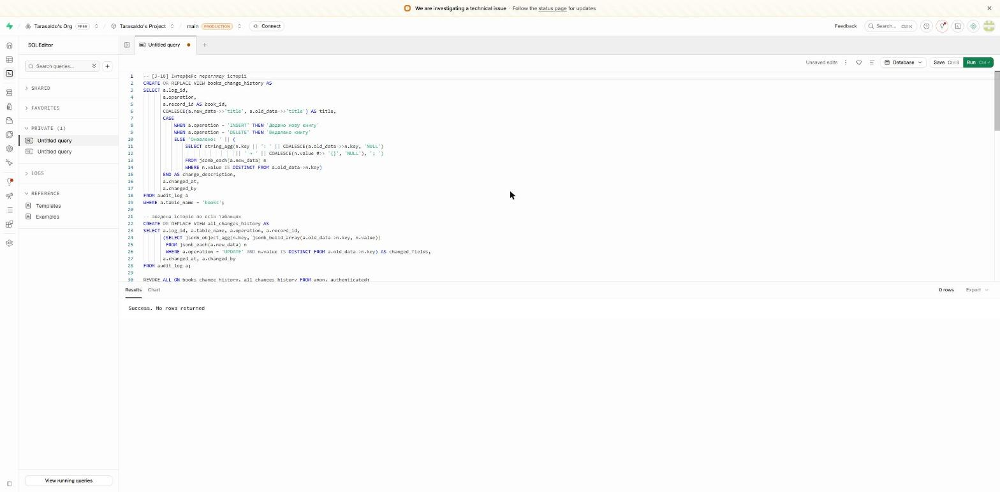
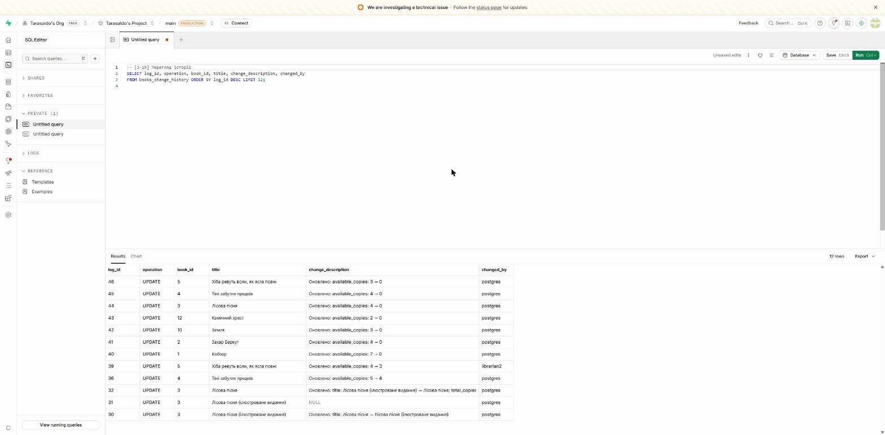

**3-20, звіт за 30 днів:**

| Таблиця | Усього | INSERT | UPDATE | DELETE |
|---|---|---|---|---|
| books | 27 | 3 | 23 | 1 |
| lendings | 5 | 2 | 3 | 0 |
| readers | 2 | 0 | 2 | 0 |
| reservations | 12 | 4 | 4 | 4 |

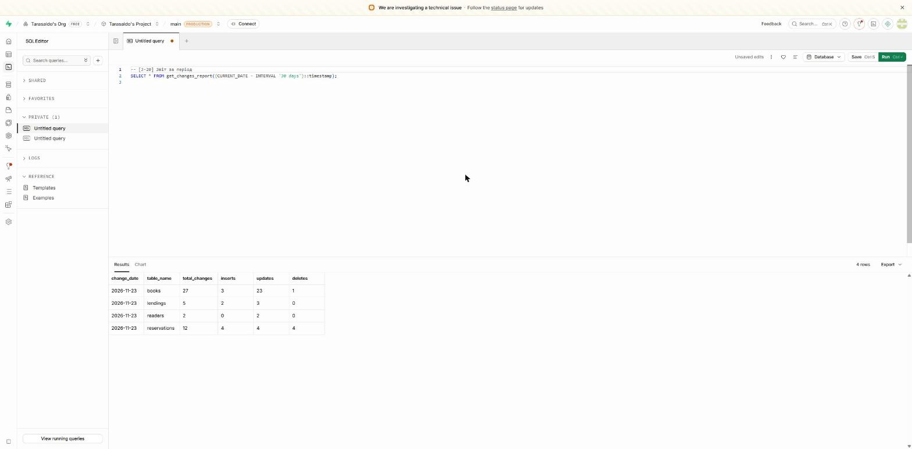

**3-21, 3-22, відкат змін за період.** Збережено мітку часу, після неї двом книгам помилково виставлено жанр «ПОМИЛКА» та 0 примірників. `rollback_books_changes(мітка)` скасував ці зміни: «Кобзар» знову «Класична поезія» з 7 примірниками, «Захар Беркут» знову «Історична проза» з 4.

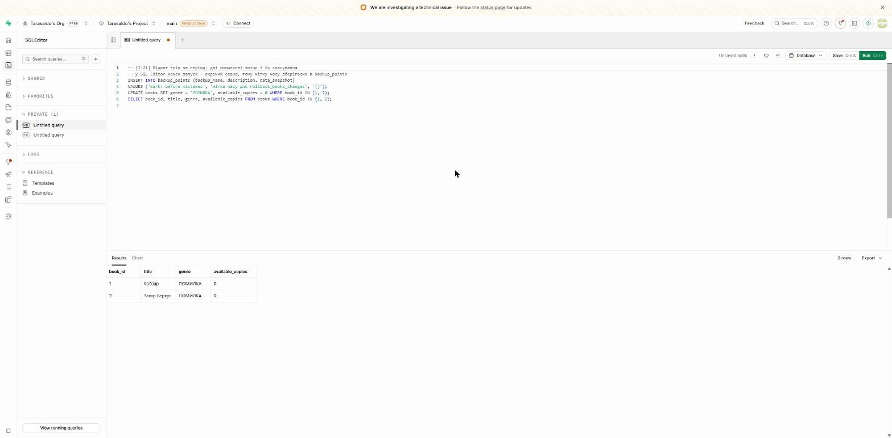
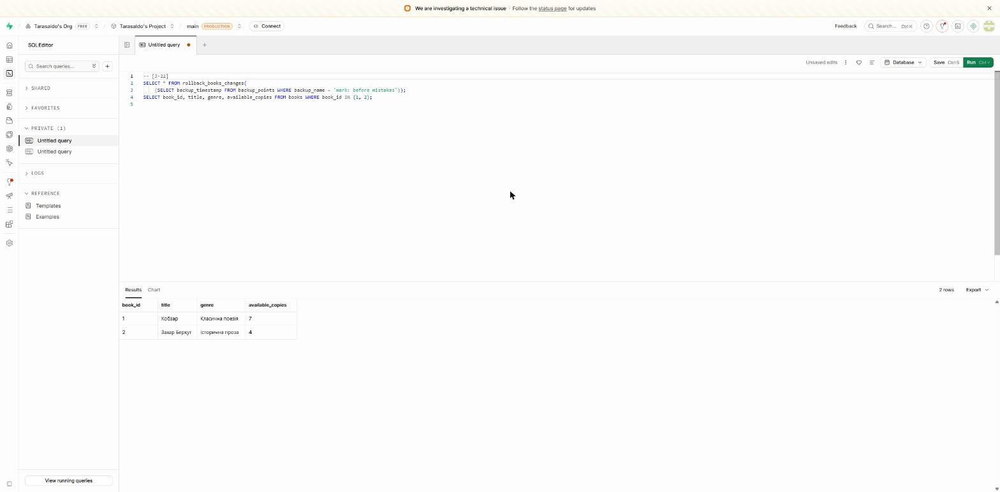

---

## Відповіді на контрольні запитання

**1. У чому полягає різниця між операторами INSERT, UPDATE та DELETE? Які обмеження необхідно враховувати при їх використанні?**

- `INSERT` додає нові рядки. Нові значення перевіряються на NOT NULL, CHECK, UNIQUE/PRIMARY KEY та на існування батьківського запису (FOREIGN KEY), див. 1-3.
- `UPDATE` змінює наявні рядки. Нові значення проходять ті самі перевірки. Якщо змінюється ключ, на який посилаються інші таблиці, діє правило `ON UPDATE` (2-8).
- `DELETE` видаляє рядки. Для нього важливі правила `ON DELETE` у дочірніх таблицях: RESTRICT/NO ACTION забороняють видалення, CASCADE видаляє залежні записи, SET NULL/SET DEFAULT змінюють їх (1-10, 2-8 – 2-10).

Для всіх трьох операторів діють права доступу (3-11, 3-13) і тригери, які можуть виконати додаткові дії (аудит, версіонування).

**2. Чому використання умови WHERE є критично важливим в операціях UPDATE та DELETE? Які наслідки можуть бути від її пропуску?**

Без `WHERE` оператор діє на **всі** рядки таблиці. У 3-15 це показано навмисно: `UPDATE books SET available_copies = 0` обнулив усі книги, а `DELETE FROM reservations` знищив усі бронювання. Наслідки такої помилки: втрата даних, каскадні видалення в інших таблицях, довгі блокування всієї таблиці. Тому застосовують такі практики:
- спочатку виконати `SELECT` з тією ж умовою;
- використовувати `RETURNING`, щоб побачити змінені рядки;
- виконувати зміни в транзакції, яку можна відкотити;
- мати резервні копії (3-14).

Supabase додатково показує попередження «destructive operation» для запитів без `WHERE`.

**3. Що таке транзакція та які властивості ACID вона забезпечує? Поясніть кожну властивість на конкретному прикладі.**

Транзакція — логічна одиниця роботи з однієї або кількох операцій, яка виконується як ціле.
- **Atomicity (атомарність).** У 1-6 успішний `UPDATE` автора відкотився разом із невдалим `DELETE`. Видача книги (1-5) або виконується повністю (запис видачі та зменшення примірників), або не виконується зовсім.
- **Consistency (узгодженість).** Транзакція не може залишити базу в стані, що порушує обмеження. Наприклад, `available_copies` не стане від'ємним або більшим за `total_copies`, а видача не посилатиметься на неіснуючу книгу.
- **Isolation (ізольованість).** У 2-11/2-14 дві транзакції змінювали ту саму книгу. Друга чекала завершення першої і побачила вже підтверджене значення 6, тож результат 5 такий самий, як при послідовному виконанні.
- **Durability (довговічність).** Після `COMMIT` зміни записані в WAL і переживуть збій сервера. Дані в базі зберігаються між сеансами SQL Editor і після перезапуску (призупинення) проєкту Supabase.

**4. Яка різниця між командами COMMIT та ROLLBACK? У яких ситуаціях використовується кожна з них?**

`COMMIT` фіксує всі зміни транзакції й робить їх видимими для інших. `ROLLBACK` скасовує всі зміни від `BEGIN`. `COMMIT` використовують, коли всі кроки бізнес-операції виконано успішно (1-5, 2-4). `ROLLBACK` використовують:
- при помилці;
- коли перевірка всередині транзакції показала, що результат неправильний (1-8);
- для «пробних» змін.

Після помилки в PostgreSQL транзакція переходить у стан aborted, і навіть `COMMIT` фактично виконує відкат (1-6).

**5. Що таке точки збереження SAVEPOINT і як вони дозволяють керувати транзакціями більш гнучко порівняно з простим ROLLBACK?**

`SAVEPOINT name` позначає місце всередині транзакції. `ROLLBACK TO SAVEPOINT name` скасовує лише зміни після цієї точки, а транзакція триває і може бути підтверджена. У 2-5 так скасовано помилкову книгу, а автора збережено. `RELEASE SAVEPOINT` видаляє точку. У PL/pgSQL кожен блок `BEGIN ... EXCEPTION` неявно створює точку збереження. Це використано у 2-6 і у виконавці відкладених операцій (3-4): помилка однієї операції не скасовує інші.

**6. Які типи обмежень цілісності ви знаєте? Як кожен з них допомагає підтримувати коректність даних у базі?**

- `PRIMARY KEY` — унікальна неNULL-ова ідентифікація рядка.
- `FOREIGN KEY` — посилальна цілісність: не можна послатись на неіснуючий запис (1-3b) або видалити запис, на який посилаються (1-6).
- `UNIQUE` — немає двох книг з однаковим ISBN чи двох читачів з однаковим email (1-3a).
- `CHECK` — довільна умова на рядок: діапазон років, `available_copies <= total_copies` (1-3c), допустимі статуси.
- `NOT NULL` — обов'язковість значення (1-3d).
- `DEFAULT` — значення за замовчуванням (наприклад, статус `Active`, `CURRENT_DATE`).
- `EXCLUDE` — заборона «перетину» значень, наприклад двох бронювань того самого ресурсу на один час.

**7. Що таке каскадні операції та які варіанти їх поведінки існують при видаленні або оновленні батьківських записів?**

Каскадні операції — це автоматичні дії над дочірніми рядками при зміні батьківського. Варіанти:
- `NO ACTION` (за замовчуванням, перевірка в кінці інструкції) і `RESTRICT` (перевірка негайно): забороняють операцію;
- `CASCADE`: видаляє або оновлює дочірні рядки;
- `SET NULL`: ставить NULL у зовнішньому ключі;
- `SET DEFAULT`: ставить значення за замовчуванням.

Усі варіанти задаються окремо для `ON DELETE` і `ON UPDATE`. У роботі використано всі: RESTRICT (`books → authors`), CASCADE (`reservations → books`), SET NULL (`books → publishers`), SET DEFAULT (`books → book_categories`), ON UPDATE CASCADE (`reservations.card_number`), див. 2-8 – 2-10.

**8. Яку роль відіграють тригери в забезпеченні цілісності даних та автоматизації операцій? Наведіть приклади їх практичного застосування.**

Тригер — функція, яку СУБД викликає автоматично до або після INSERT/UPDATE/DELETE (для кожного рядка або інструкції). Тригер неможливо «забути» викликати з програми, тож правило діє для всіх клієнтів. Приклади з роботи:
- аудит змін у `audit_log` (2-2);
- версіонування `books_versions` (3-1);
- запис того, хто змінив дані (`changed_by = librarian2`, 3-12).

Інші типові застосування:
- автоматичне оновлення `updated_at`;
- перевірки, які не виразити через CHECK (наприклад, ліміт книг у читача);
- підтримка денормалізованих лічильників;
- заборона змін у закритих періодах.

Тригер `BEFORE` може змінити або відхилити рядок, `AFTER` бачить остаточний результат.

**9. Чому необхідно використовувати блокування записів при паралельному доступі? Які проблеми можуть виникнути без них?**

Без блокувань дві транзакції можуть одночасно прочитати однакове значення і перезаписати результат одна одної (втрачене оновлення). Наприклад, обидва бібліотекарі бачать 1 вільний примірник і обидва видають книгу. Можлива також видача одного бронювання двом читачам або порушення бізнес-правил, що перевіряються читанням. `SELECT ... FOR UPDATE` блокує рядок до кінця транзакції: інша транзакція чекає (2-14, 37 с) і бачить вже оновлене значення. Варіанти без очікування:
- `NOWAIT` одразу повертає помилку (2-12);
- `SKIP LOCKED` пропускає зайняті рядки (2-15), що підходить для черг.

Блокування треба тримати якомога коротше і брати в однаковому порядку, інакше можливі довгі очікування та взаємоблокування (deadlock). PostgreSQL виявляє deadlock і скасовує одну з транзакцій.

**10. Як рівні ізоляції транзакцій впливають на можливі аномалії при паралельному виконанні операцій? Який рівень слід обирати для різних сценаріїв?**

| Рівень | Брудне читання | Неповторюване читання | Фантоми | Аномалії серіалізації |
|---|---|---|---|---|
| READ UNCOMMITTED | у PostgreSQL неможливе (працює як READ COMMITTED) | можливе | можливі | можливі |
| READ COMMITTED (за замовчуванням) | ні | можливе | можливі | можливі |
| REPEATABLE READ | ні | ні | у PostgreSQL ні | можливі |
| SERIALIZABLE | ні | ні | ні | ні |

Вибір рівня:
- **READ COMMITTED** підходить для більшості коротких OLTP-операцій (видача, повернення), особливо разом із `FOR UPDATE` для критичних рядків.
- **REPEATABLE READ** підходить для звітів і вивантажень, яким потрібен узгоджений знімок даних на початок транзакції (наприклад, `get_changes_report` або створення контрольної точки).
- **SERIALIZABLE** підходить для складних перевірок інваріантів між кількома рядками чи таблицями (ліміт книг на читача, відсутність перетину бронювань), коли блокування окремих рядків недостатньо. Застосунок має бути готовий повторити транзакцію при помилці `40001 serialization_failure`.

Вищий рівень ізоляції — це менше аномалій, але більше конфліктів і повторів.

---

## Висновок

У ході лабораторної роботи в PostgreSQL (Supabase) створено базу даних бібліотеки і виконано завдання всіх трьох рівнів.

- **Рівень 1.** Перевірено роботу обмежень PRIMARY KEY, FOREIGN KEY, UNIQUE, CHECK, NOT NULL. Виконано безпечні `UPDATE`/`DELETE` з попереднім `SELECT` і `RETURNING`. Транзакція видачі книги підтверджується `COMMIT`. Помилка всередині транзакції відкочує і вже виконані кроки.
- **Рівень 2.** Додано бронювання та журнал змін. Реалізовано складну транзакцію повернення книги з видачею наступному в черзі. Показано всі види каскадних дій: CASCADE, SET NULL, SET DEFAULT, RESTRICT, ON UPDATE CASCADE. Використано SAVEPOINT (явно і через блоки EXCEPTION). Створено універсальний тригер аудиту. На трьох паралельних сеансах продемонстровано `FOR UPDATE`: очікування 37 с, `NOWAIT` і `SKIP LOCKED`.
- **Рівень 3.** Реалізовано:
  - версіонування з отриманням стану на будь-який момент і відкатом до версії;
  - відкладені операції, які виконує pg_cron, з окремою точкою збереження на кожну операцію;
  - процедури `issue_book`, `return_book` і функцію `extend_lending` з бізнес-перевірками;
  - ролі з правами аж до рівня окремих стовпців;
  - контрольні точки (щоденні через pg_cron) та повне відновлення після «збою» без `WHERE`;
  - представлення історії змін, звіт за період і відкат змін книг за інтервал часу.

Головний висновок: транзакції, обмеження та тригери переносять правила цілісності з коду застосунку в саму СУБД. Тоді дані залишаються коректними незалежно від того, який клієнт і в якому порядку їх змінює.
